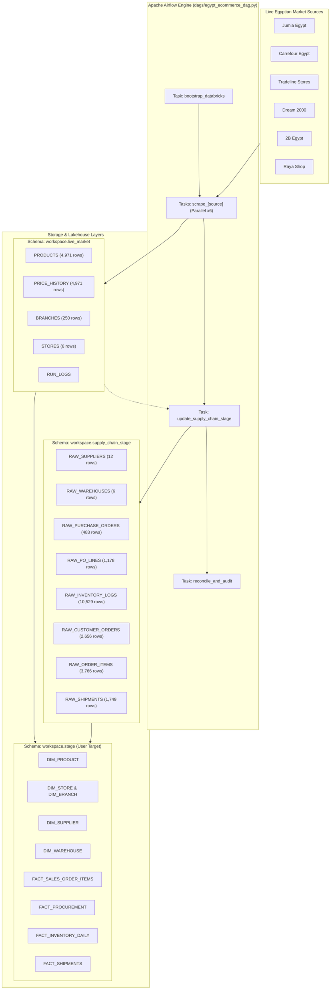
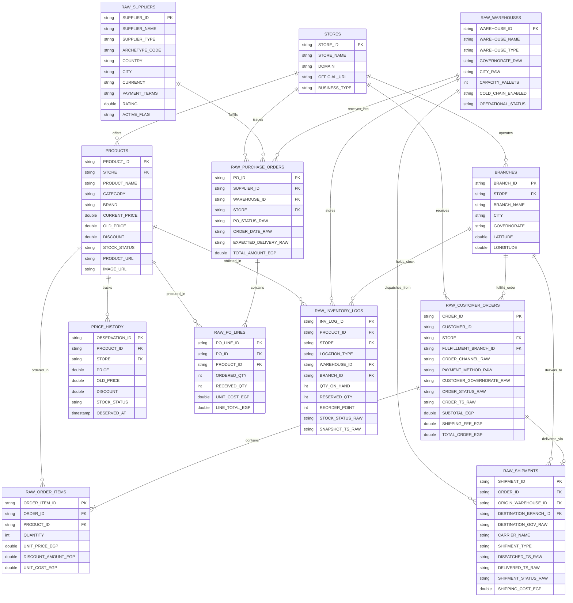

# Egypt E-Commerce & Retail Supply Chain Intelligence Platform

An enterprise-grade, end-to-end Data Engineering, Market Intelligence, and Supply Chain Platform for the Egyptian retail ecosystem. Built on **Apache Airflow**, **DuckDB**, and **Databricks Delta Lake** (Lakehouse architecture).

---

## 1. Executive Summary & Project Story

This platform ingests, validates, normalizes, and models large-scale retail market data alongside internal enterprise supply chain (ERP) operations across Egypt:

1. **Live Market Ingestion (`workspace.live_market`):**
   - Continuously scrapes real-world price, discount, and availability metrics across 6 major Egyptian retailers: **Jumia Egypt**, **Carrefour Egypt**, **Tradeline Stores** (Apple Authorized Reseller), **Dream 2000**, **2B Egypt**, and **Raya Shop**.
   - Captures **4,971 live products**, **4,971 historical price observations**, **250 physical store branches** across 27 Egyptian governorates, and **6 retailer entities**.
   - Features robust anti-ban protection: User-Agent header rotation, polite jitter, and automated Chromium/Playwright fallback to bypass Cloudflare JA3 TLS and rate-limit obstacles.

2. **Supply Chain & ERP Stage (`workspace.supply_chain_stage`):**
   - Synthesizes realistic, domain-accurate operational ERP data anchored directly to the 4,971 live products and 250 physical branches.
   - Organizes products into **10 Operational Supply Chain Archetypes** (ranging from high-ticket Apple Flagship and Computing to cold-chain agro-food and FMCG detergents).
   - Generates **8 RAW transactional tables** (**19,400+ records**) with realistic OLTP nuances (mixed timestamp formats, unstandardized Egyptian city/governorate spellings, mixed casing, and controlled webhook retry duplicates) providing a realistic data-cleaning foundation.

3. **Dimensional Star Schema Target (`workspace.stage`):**
   - A dedicated staging layer reserved for downstream modeling into standard Conformed Dimensions (`DIM_PRODUCT`, `DIM_STORE`, `DIM_BRANCH`, `DIM_SUPPLIER`, `DIM_WAREHOUSE`, `DIM_DATE`) and Fact Tables (`FACT_SALES_ORDER_ITEMS`, `FACT_PROCUREMENT`, `FACT_INVENTORY_DAILY`, `FACT_SHIPMENTS`).

4. **Unified Daily Orchestration (Apache Airflow):**
   - A single orchestrated DAG (`egypt_ecommerce_etl`) in [`dags/egypt_ecommerce_dag.py`](dags/egypt_ecommerce_dag.py) that executes daily:
     $$\text{Bootstrap Databricks} \longrightarrow \text{Scrape 6 Retailers in Parallel} \longrightarrow \text{Update Supply Chain Incremental Batch} \longrightarrow \text{Reconcile \& Audit Parity}$$

---

## 2. Lakehouse Architecture & Layer Design



---

## 3. Data Model & Entity-Relationship Diagram (ERD)

The diagram below maps all 13 operational tables across `workspace.live_market` and `workspace.supply_chain_stage`, illustrating how every operational order, shipment, purchase order, and inventory log anchors to the live product catalog and physical branch network:



---

## 4. Table Catalog & Data Dictionary

### 4.1 Schema: `workspace.live_market` (Scraped Retail Data)

| Table Name | Live Count | Primary Key | Description |
| :--- | :---: | :--- | :--- |
| `PRODUCTS` | **4,971** | `PRODUCT_ID` | Canonical product dimension storing the latest current price, stock status, URLs, brand, and category. |
| `PRICE_HISTORY` | **4,971** | `OBSERVATION_ID` | Append-only observation log recording price fluctuations, discounts, and timestamped availability. |
| `STORES` | **6** | `STORE_ID` | Master retailer catalog: Jumia, Carrefour, Tradeline, Dream 2000, 2B Egypt, and Raya Shop. |
| `BRANCHES` | **250** | `BRANCH_ID` | Physical store locations across 27 Egyptian governorates with geo-coordinates and city details. |
| `RUN_LOGS` | **7+** | `RUN_ID` | Pipeline audit trail tracking collection durations, items parsed, and success status. |

### 4.2 Schema: `workspace.supply_chain_stage` (Raw ERP Operational Data)

| Table Name | Live Count | Primary Key | Description |
| :--- | :---: | :--- | :--- |
| `RAW_SUPPLIERS` | **12** | `SUPPLIER_ID` | Master suppliers categorized across 10 supply chain archetypes (Apple tier-1, OEM, FMCG, IT). |
| `RAW_WAREHOUSES` | **6** | `WAREHOUSE_ID` | Central distribution centers (6th of October, 10th of Ramadan, Obour, Borg El Arab, Mansoura, Assiut). |
| `RAW_PURCHASE_ORDERS` | **483** | `PO_ID` | B2B supplier procurement orders with raw dates, delivery ETAs, and ~1.5% webhook retry duplicates. |
| `RAW_PO_LINES` | **1,178** | `PO_LINE_ID` | Line-item procurement details containing ordered/received quantities, unit costs, and live `PRODUCT_ID`s. |
| `RAW_INVENTORY_LOGS` | **10,529** | `INV_LOG_ID` | Daily stock-on-hand snapshots across both central warehouses and retail branches. |
| `RAW_CUSTOMER_ORDERS` | **2,656** | `ORDER_ID` | B2C omnichannel customer sales orders (Online, Mobile App, Click & Collect, POS in-store). |
| `RAW_ORDER_ITEMS` | **3,766** | `ORDER_ITEM_ID` | Line-item order details with unit prices, applied discounts, and unit wholesale costs. |
| `RAW_SHIPMENTS` | **1,749** | `SHIPMENT_ID` | Logistics shipments with carriers (Bosta, Mylerz, Aramex, Raya Fleet), transit times, and delivery status. |

---

## 5. The 10 Supply Chain Archetypes

All 129 `(STORE, CATEGORY)` pairs map deterministically to one of 10 operational profiles:

1. **`APPLE_FLAGSHIP`** (iPhones, Macs, iPads, Apple Watches): High ticket, 6.5%–11.5% margin, 10–21 day lead time, low reorder quantities.
2. **`APPLE_ECOSYSTEM_ACC`** (AirPods, Straps, Cases, Chargers): High margin (18%–28%), 5–12 day lead time, medium basket velocity.
3. **`SMARTPHONES_TABLETS`** (Samsung, Xiaomi, Oppo, Realme): High velocity, 9%–15.5% margin, 4–10 day lead time.
4. **`LAPTOPS_COMPUTING`** (Laptops, Desktops, Monitors): High ticket, 8.5%–14% margin, 7–15 day lead time.
5. **`MAJOR_APPLIANCES_TV`** (Refrigerators, Washers, Screens): Bulky logistics, 11%–18% margin, 5–14 day lead time, unit order cap = 1.
6. **`SMALL_APPLIANCES_COFFEE`** (Coffee makers, Blenders, Vacuums): Medium velocity, 15%–24% margin, 4–9 day lead time.
7. **`TECH_ACC_PERIPHERALS`** (Cables, Power Banks, Keyboards, Gaming): Fast moving, 24%–38% margin, 3–7 day lead time.
8. **`FMCG_FRESH_COLDCHAIN`** (Meats, Poultry, Dairy, Frozen): Dedicated cold-chain fleet, 16%–26% margin, 1–2 day lead time, high velocity.
9. **`FMCG_DRY_HOUSEHOLD`** (Detergents, Beverages, Pantry): Bulk pallet storage, 14%–23% margin, 2–4 day lead time, multi-unit baskets.
10. **`BEAUTY_HEALTH_DECOR`** (Personal Care, Grooming, Home Accents): 22%–34% margin, 3–8 day lead time.

---

## 6. Raw Data Cleaning Checklist (Reference Spec for `workspace.stage`)

When building your Dimensional Star Schema in `workspace.stage`, resolve the following injected OLTP anomalies:

1. **Primary Key Deduplication:**
   - Use `ROW_NUMBER() OVER (PARTITION BY <PK> ORDER BY <TIMESTAMP> DESC) = 1` on:
     - `RAW_PURCHASE_ORDERS` (`PO_ID`)
     - `RAW_INVENTORY_LOGS` (`INV_LOG_ID`)
     - `RAW_CUSTOMER_ORDERS` (`ORDER_ID`)
2. **Timestamp Normalization:**
   - Ingest columns formatted in ISO-8601 (`yyyy-MM-dd'T'HH:mm:ss'Z'`), standard SQL (`yyyy-MM-dd HH:mm:ss`), day-first (`dd/MM/yyyy HH:mm`), and slash-delimited (`yyyy/MM/dd HH:mm:ss`) using `COALESCE(TRY_TO_TIMESTAMP(...))`.
3. **Governorate & City Standardization:**
   - Map messy Arabic/English city strings (`"Cairo"`, `"CAIRO "`, `"Al Qahirah"`, `"القاهرة"`, `"Greater Cairo"`, `"6th of October - Giza"`) into standard canonical governorates.
4. **Derived Financial KPIs:**
   - Compute in `FACT_SALES_ORDER_ITEMS`:
     $$\text{Gross Revenue} = \text{QUANTITY} \times \text{UNIT\_PRICE\_EGP}$$
     $$\text{Net Revenue} = \text{Gross Revenue} - \text{COALESCE}(\text{DISCOUNT\_AMOUNT\_EGP}, 0)$$
     $$\text{Total Cost} = \text{QUANTITY} \times \text{UNIT\_COST\_EGP}$$
     $$\text{Gross Profit} = \text{Net Revenue} - \text{Total Cost}$$
     $$\text{Gross Margin \%} = \left(\frac{\text{Gross Profit}}{\text{Net Revenue}}\right) \times 100$$

---

## 7. CLI Quickstart & Execution

```bash
# 1. Run live extraction for all stores (DuckDB + Databricks sync)
.venv/bin/python3 dwh/pipeline.py --live --limit 1000

# 2. Run daily incremental supply chain sync (appends new orders, updates inventory & shipments)
.venv/bin/python3 dwh/supply_chain_generator.py --incremental-daily

# 3. Trigger full Airflow DAG run
.venv/bin/airflow dags trigger egypt_ecommerce_etl

# 4. Check data quality, nulls, and parity across DuckDB and Databricks
.venv/bin/python3 -c "from dags.egypt_ecommerce_dag import task_reconcile_and_audit; print(task_reconcile_and_audit())"
```
