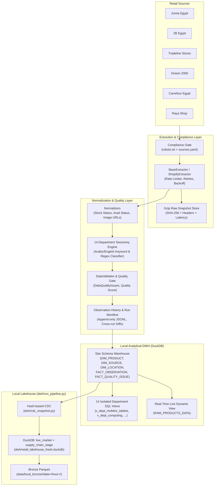
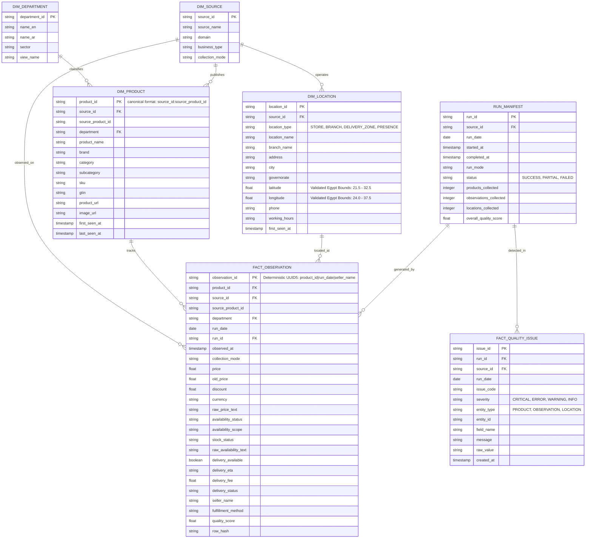

# Egypt E-Commerce Data Platform — Architecture Reference

## 1. Executive Summary & Vision

The **Egypt E-Commerce Data Platform** is an enterprise data acquisition, normalization, validation, and analytics pipeline. It systematically extracts, cleanses, classifies, and synchronizes product pricing, availability, and retail geography across major Egyptian retail and e-commerce platforms (including Jumia, 2B, Carrefour, Tradeline, Dream2000, and Raya).

The architecture is designed around four foundational pillars:
1. **Compliance & Legal Honesty:** Hard automated gates (`robots.txt` enforcement, ToS classification, explicit user-agent identification).
2. **Semantic Precision & Data Integrity:** Clear separation between physical store inventory and delivery zones, canonical stock status mapping, and deterministic deduplication.
3. **Analytical Star Schema:** Local DuckDB warehouse with 14 isolated canonical department partitions and dynamic real-time views.
4. **Local-First Change Capture:** Hash-based CDC (`dwh/cdc_snapshot.py`) into `dwh/retail_lakehouse_fresh.duckdb` and partitioned Bronze Parquet (`data/local_bronze/`), ready for a future ADLS Gen2 hand-off.

---

## 2. End-to-End System Architecture

---

## 3. Dimensional Data Model (Star Schema)

The analytical core of the platform is structured as an enterprise **Star Schema**, implemented in DuckDB (legacy backup `dwh/egypt_ecommerce.duckdb`; active DB is `dwh/retail_lakehouse_fresh.duckdb`):

---

## 4. The 14 Canonical Departments & Dedicated SQL Views

Every product ingested into the warehouse is deterministically categorized into one of 14 canonical departments using keyword and regex classification (`normalization/taxonomy.py`). Each department possesses an isolated, dedicated SQL View in DuckDB:

| # | Department ID | English Name | Arabic Name | Sector | Dedicated SQL View |
|---|---|---|---|---|---|
| 1 | `mobiles_tablets` | Mobiles & Tablets | الموبايلات والتابلت والإكسسوارات | Tech & Electronics | `v_dept_mobiles_tablets` |
| 2 | `computing` | Computing & Laptops | اللابتوب والكمبيوتر ومستلزماته | Tech & Electronics | `v_dept_computing` |
| 3 | `electronics_tv` | Electronics & TVs | الإلكترونيات والشاشات والصوتيات | Tech & Electronics | `v_dept_electronics_tv` |
| 4 | `home_appliances` | Home Appliances | الأجهزة المنزلية والكهربائية | Home & Living | `v_dept_home_appliances` |
| 5 | `fresh_meats_poultry` | Fresh Meats & Poultry | اللحوم والدواجن والأسماك الطازجة | Supermarket & FMCG | `v_dept_fresh_meats_poultry` |
| 6 | `dairy_cheese_eggs` | Dairy, Cheese & Eggs | الألبان والجبن والبيض | Supermarket & FMCG | `v_dept_dairy_cheese_eggs` |
| 7 | `fruits_vegetables` | Fruits & Vegetables | الخضروات والفواكه الطازجة | Supermarket & FMCG | `v_dept_fruits_vegetables` |
| 8 | `grocery_pantry` | Grocery & Pantry | البقالة والسلع الغذائية التموينية | Supermarket & FMCG | `v_dept_grocery_pantry` |
| 9 | `beverages` | Beverages | المشروبات والعصائر والقهوة والشاي | Supermarket & FMCG | `v_dept_beverages` |
| 10 | `bakery_snacks` | Bakery & Snacks | المخبوزات والحلويات والسناكس | Supermarket & FMCG | `v_dept_bakery_snacks` |
| 11 | `frozen_foods` | Frozen Foods | الأغذية المجمدة والجاهزة | Supermarket & FMCG | `v_dept_frozen_foods` |
| 12 | `household_cleaning` | Household & Cleaning | المنظفات والورقيات ومستلزمات المنزل | Home & Living | `v_dept_household_cleaning` |
| 13 | `personal_care_beauty`| Beauty & Personal Care | العناية الشخصية والجمال | Health & Beauty | `v_dept_personal_care_beauty` |
| 14 | `other` | Other & General Goods | أخرى ومستلزمات متنوعة | General Merchandise | `v_dept_other` |

---

## 5. Dynamic Live Views vs. Static Tables

To provide seamless access to BI tools, dashboards, and analytical consumers without manual joins, the platform provides two unified dynamic interfaces:

1. **`RAW_PRODUCTS_DATA` (Live Dynamic View):**
   - Implemented as a view joining `FACT_OBSERVATION` with `DIM_PRODUCT` and `DIM_SOURCE`.
   - Guaranteed 100% synchronization: whenever an observation is upserted or deduplicated, `RAW_PRODUCTS_DATA` immediately reflects the change.
   - Preserves all enriched fields: `product_id`, `product_name`, `brand`, `category`, `subcategory`, `department`, `price`, `old_price`, `discount`, `availability_status`, `stock_status`, `image_url`, and `product_url`.

2. **`RAW_SOURCE_DATA` (Unified Flat Table & 6 Source Views):**
   - Flattens source-level payloads with enriched category taxonomy and full raw JSON audit payload.
   - Exposes 6 dedicated per-source views: `V_RAW_SOURCE_JUMIA`, `V_RAW_SOURCE_TWO_B`, `V_RAW_SOURCE_CARREFOUR`, `V_RAW_SOURCE_TRADELINE`, `V_RAW_SOURCE_DREAM2000`, `V_RAW_SOURCE_RAYA`.

---

## 6. Local CDC Snapshots & Bronze Parquet

- `STATE_HASH = SHA-256(PRODUCT_ID | CURRENT_PRICE | OLD_PRICE | DISCOUNT | STOCK_STATUS)` (fixed 2-decimal numbers, NULL = empty, stock upper-cased).
- Unchanged hash: no `PRICE_HISTORY` row, only `PRODUCTS.LAST_CHECKED_AT` is updated.
- New / changed hash: `PRODUCTS` upsert + one timestamped `PRICE_HISTORY` row (`CHANGE_TYPE` = `INSERT` | `UPDATE`); only those rows go to `data/local_bronze/market_changes/`.
- Every run also writes its ERP deltas (and status progressions as `_change_op = UPDATE`) under `data/local_bronze/<table>/date=YYYY-MM-DD/hour=HH/` (UTC).

---

## 7. Production Reliability & Operational Governance

1. **Process Concurrency Lock (`fcntl.flock`):**
   - `dwh/run_pipeline.py` holds `dwh/.run_pipeline.lock` during a run; an overlapping run exits cleanly (DuckDB is single-writer).
2. **Automated Log Rotation & Retention:**
   - Automated pruning removes run logs older than 14 days (`find ... -mtime +14 -delete`).
   - The cron log (`cron_1900.log`) is monitored; if it exceeds 20MB, it is automatically rotated to `.1`.
3. **HTTP Rate-Limiting & `Retry-After` Compliance:**
   - On encountering HTTP 429 (Too Many Requests) or 503 (Service Unavailable), the extractor inspects the `Retry-After` header.
   - Supports both integer seconds and RFC 2822 HTTP date formats, applying safe exponential backoff capped at 60 seconds.
4. **Deterministic Observation Deduplication:**
   - In-memory and DWH upsert deduplication utilizes deterministic UUID5 hashes generated from `(product_id, run_date, seller_name)`.
   - Prevents duplicate rows on repeated same-day runs while accurately capturing price or stock transitions across days.
5. **Geographic Coordinate Sanitization:**
   - All physical branch coordinates are strictly bounded to the legitimate Egyptian geographic bounding box ($21.5^\circ \le \text{Latitude} \le 32.5^\circ$, $24.0^\circ \le \text{Longitude} \le 37.5^\circ$). Out-of-bounds or placeholder coordinates are sanitized to `NULL` to protect GIS applications.
